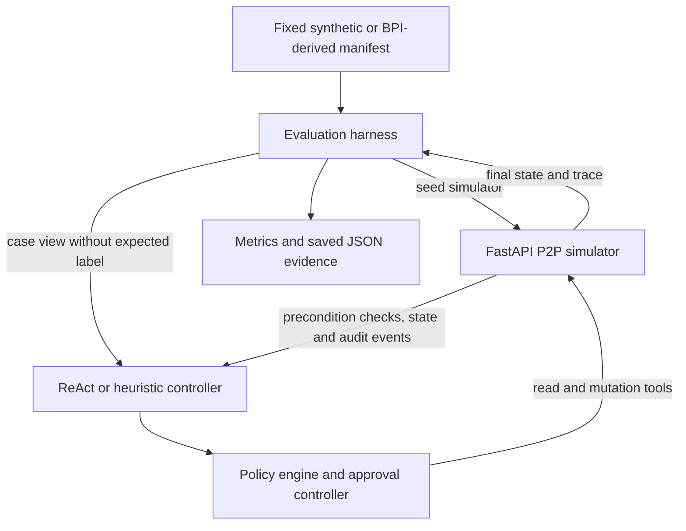

# Policy-Grounded Agentic Control for Purchase-to-Pay Automation

AI4015 Agentic Artificial Intelligence · Phase 2 project

This repository contains a locally runnable purchase-to-pay (P2P) workflow simulator, two baseline controllers, policy and approval components, experiment scripts, fixed evaluation manifests, saved results, a development log, and the source of the accompanying research paper.

The study examines how explicit policy checks and review controls affect invoice-state correctness, visibility of policy-risk evidence, and execution effort in a controlled P2P workflow. All saved evaluation results in this repository were generated with the deterministic offline backend. The project does **not** connect to an ERP, initiate payments, or demonstrate a production deployment. Its findings concern the local simulator and its constructed evaluation cases.

## Project at a glance

| Item | Description |
|---|---|
| Business process | Purchase-to-pay invoice processing with purchase-order, invoice, and goods-receipt checks |
| Environment | Local FastAPI simulator with server-side transition preconditions and audit history |
| Controllers | Structured ReAct-style planner and deterministic heuristic workflow |
| Primary benchmark | Fixed 100-case synthetic manifest, seed 2019 |
| Transfer fixture | 100 BPI Challenge 2019-derived cases with reconstructed proxy invoice fields and labels |
| Main experiments | E1 baseline, E2 domain comparator, E3 proposed configuration, E4 trace-derived transfer, E5 factorial ablation, E6 efficiency and reliability |
| Default model backend | Offline deterministic planner; this is not an LLM evaluation |
| Main result | All evaluated configurations reached 1.00 exact match on their fixture labels; the policy detector surfaced risk in 40/100 synthetic cases, while the server-side simulator prevented unsafe mutations |
| Reproduction summary | [`results/phase2_summary.md`](results/phase2_summary.md) |
| Machine-readable evidence | [`results/phase2_evidence.json`](results/phase2_evidence.json) |

## Research question and motivation

P2P automation changes financial workflow state. A wrong invoice clearance can create financial, compliance, or audit risk even when the agent's action appears plausible. The study asks:

> How do explicit policy checks and review controls affect end-state correctness, policy-risk visibility, and execution cost in a simulated P2P workflow?

The Phase 1 base paper selected for the course is Fionda, Ielo, and Ricca's 2025 IJCAI study of language-model translation of Declare process constraints and symbolic semantic checking. That work addresses a different task from executing procurement transactions. This repository does not implement its Declare-translation method. Experiment E2 is transparently labeled a **heuristic domain comparator**, not a reproduction of the base paper. A like-for-like E2 remains open work and the results below must not be presented as a comparison against the base paper.

The project evaluates three related research motivations:

1. **Policy and safety controls:** a workflow should expose evidence problems and prevent state changes that violate invoice, purchase-order, or receipt checks.
2. **Transfer to procurement traces:** process-level evidence should be explored in a procurement-related trace setting, while separating source-observed events from fields reconstructed to make transaction replay possible.
3. **Evaluation beyond correctness:** exact final-state match alone does not describe alerts, interventions, unsafe mutations, audit traces, tool use, latency, or model-token estimates.

These motivations are addressed only partially by the current experiments. In particular, the simulator enforces its own clearance invariants in every ablation condition, BPI labels are proxies, and the approval toggle had no aggregate effect in E5.

### Questions evaluated by the implemented experiments

| Question | Experiment evidence | What the current evidence can answer |
|---|---|---|
| Does an enabled evidence policy layer make risky fixture cases visible while preserving terminal-state agreement? | E1 versus E3 and the policy toggle in E5 | The detector flags 40/100 synthetic cases when enabled; exact match remains 1.00. This demonstrates alerting on constructed evidence, not a reduction in real unsafe transactions. |
| Does the workflow behave similarly on procurement-derived process traces? | E4 on 100 BPI-derived replay cases | Controllers agree with 100/100 reconstructed proxy labels and flag 55/100 cases. The source log has no invoice-level ground truth, so this is not validated transfer accuracy. |
| Do policy and approval toggles independently change outcome, risk, or intervention metrics? | Eight-condition E5 factorial ablation | Policy toggling changes alerts; approval toggling changes none of the reported aggregates in this deterministic fixture. Simulator guards remain active, limiting causal attribution. |

These are questions evaluated by the implemented runs, not preregistered hypotheses or evidence of deployment effectiveness.

## Changes since Phase 1

Phase 2 retained the purchase-to-pay scope and local baseline while extending it into an executable evaluation system. The work added:

- a deterministic mock procurement API for purchase orders, invoices, receipts, holds, approvals, and audit history;
- a bounded structured-action ReAct loop alongside the original deterministic heuristic controller;
- policy checks and risk-based approval recommendations with separate policy and approval switches for ablation;
- simulator-side enforcement of invoice verification, duplicate-invoice, amount-match, and receipt-completeness preconditions;
- failure handling for invalid planner output, rejected mutations, and eligible retry/reconciliation cases;
- fixed synthetic and trace-derived manifests, E1–E6 experiment scripts, result aggregation, and representative trace export;
- optional OpenAI-compatible and local Ollama backends for development, while keeping the reported evaluation offline and deterministic;
- a LaTeX paper source and a compact evidence report linked to saved experiment artifacts.

These changes do not amount to a like-for-like implementation of the Phase 1 base paper. The selected paper studies natural-language translation of Declare constraints and formal semantic checking; the current implementation instead evaluates P2P state transitions.

## What was built

### End-to-end workflow

The runnable workflow connects fixed cases to a local simulator, invokes a selected controller, records tool calls and state transitions, and evaluates final invoice state. The evaluator resets the simulator before each run. It passes agents a case view with `expected_state` removed; the evaluator uses that label only after the agent finishes to calculate outcome metrics.



The simulator is the final authority on accepted transitions. A risk alert, a rejected tool call, and a completed unsafe mutation are distinct events. The evaluation reports these separately. In the current fixtures, the server-side checks reject unsafe clearances, so a zero unsafe-mutation rate does not establish that the policy or approval layer alone prevented those actions.

### Components

| Path | Responsibility |
|---|---|
| `main.py` | CLI for validation, simulator startup, manifest generation, baseline runs, and reports |
| `src/simulator/` | FastAPI endpoints, request schemas, in-memory procurement state, state-transition checks, and audit records |
| `src/agents/react_agent.py` | Bounded structured-action loop, tool client, offline/OpenAI-compatible/Ollama backends, retries for eligible calls, and fail-closed handling |
| `src/agents/heuristic_agent.py` | Deterministic branch-based comparator using invoice, PO, and receipt evidence |
| `src/policies/engine.py` | Explicit checks for invoice verification, duplicate evidence, amount mismatch, and insufficient receipt quantity |
| `src/orchestration/controller.py` | Evidence-based risk score and approve/review/hold recommendation |
| `src/safeguards/compensation.py` | Builds evidence-based compensation suggestions for risky or inconsistent states; this module is not independently evaluated as an agent action in the saved E1–E6 runs |
| `src/pipeline/` | Synthetic case manifest utilities and BPI XES/CSV profiling and replay-manifest construction |
| `src/evaluation/` | Paired evaluation, outcome metrics, ablation execution, and result formatting |
| `experiments/` | Reproduction entry points for E1–E6 and representative-trace export |
| `docs/devlog.md` | Concise record of implementation iterations, observed limitations, changes, and measured effects |
| `data/test_manifest_100.json` | Frozen primary synthetic fixture used by the saved results |
| `logs/` | Selected successful and policy-risk trajectories with tool and transition records |
| `results/` | Compact experiment outputs, evidence summary, and detailed phase summary |
| `submission/paper.tex`, `submission/references.bib` | Current paper source and bibliography |
| `tests/` | Deterministic component and workflow tests |

### Simulator API

The local API models purchase orders, invoices, receipt evidence, holds, and audit history. Start it with `python main.py --serve`; the interactive schema is available at `http://127.0.0.1:8000/docs`.

| Method | Route | Purpose |
|---|---|---|
| `GET` | `/purchase-orders/{po_item_id}` | Read PO amount, quantity, matching type, and status |
| `GET` | `/invoices/{invoice_id}` | Read invoice amount, verification, duplicate flag, and status |
| `GET` | `/goods-receipts/{po_item_id}` | Read receipt events and verified quantity |
| `POST` | `/goods-receipts/{po_item_id}/verify` | Verify complete receipt evidence (idempotent) |
| `POST` | `/invoices/{invoice_id}/clear` | Simulate invoice clearance after server-side precondition checks |
| `POST` | `/cases/{case_id}/hold` | Place a case on hold for review |
| `POST` | `/cases/{case_id}/approval` | Record an approval decision |
| `GET` | `/cases/{case_id}/audit` | Read tool-call and transition history |

No endpoint connects to an external ERP or sends a payment.

## Data and benchmark design

### Synthetic manifest

The main evaluation uses the committed 100-case manifest generated with seed `2019`. It contains 20 cases in each of five strata:

| Scenario stratum | Cases | Constructed expected outcome |
|---|---:|---|
| Two-way matching | 20 | Cleared |
| Complete three-way matching | 20 | Cleared |
| Three-way matching with missing receipt | 20 | Held |
| Consignment | 20 | Cleared |
| Fault-injected evidence | 20 | Held |

The fixture contains 60 cases labeled cleared and 40 labeled held. The fault-injected group includes five amount mismatches, five duplicate invoices, five incomplete receipts, and five unverified invoices. These are deliberate scenario counts, not estimates of procurement fault prevalence.

### BPI Challenge 2019 replay

The optional replay pipeline profiles a BPI Challenge 2019 event log and builds 100 purchase-order-grouped cases. The source is an event log, not invoice-level transaction truth. Invoice identifiers, amounts, some quantities, and expected terminal statuses are reconstructed by the replay builder. E4 therefore measures agreement with **proxy labels**, not invoice accuracy or verified generalization. The raw XES file is intentionally excluded from Git; see [BPI fixture instructions](#bpi-challenge-2019-replay).

Dataset record: [BPI Challenge 2019, 4TU.ResearchData](https://doi.org/10.4121/uuid:d06aff4b-79f0-45e6-8ec8-e19730c248f1), CC BY 4.0. Obtain the dataset from its source and comply with its license and terms.

## Experimental design

All saved runs use fixed manifests, a deterministic local simulator, and the offline scripted backend. These results are repeatable workflow measurements; they are not measurements of a hosted LLM's reasoning. The E1–E6 scripts save reproducible JSON output in `results/`.

| ID | Experiment | Configuration and purpose |
|---|---|---|
| E1 | Baseline | ReAct controller with policy reporting and approval disabled on 100 synthetic cases. Its zero alert rate means detection is disabled, not that no risky cases exist. |
| E2 | Domain comparator | Deterministic heuristic with policy and approval enabled on the synthetic manifest. It is not the selected base paper's method. |
| E3 | Proposed configuration | ReAct controller with policy and approval enabled on the same 100 synthetic cases. |
| E4 | Trace-derived transfer | ReAct and heuristic controllers on 100 BPI-derived replay cases, scored against reconstructed proxy labels. |
| E5 | Factorial ablation | Eight configurations: two agents × policy on/off × approval on/off, each on the same 100 synthetic cases. |
| E6 | Efficiency and reliability | Local latency, estimated token count, tool-call count, end-state match, unsafe mutation, and offline cost for the controlled configurations. |

E5 independently toggles policy and approval rather than removing both together. However, because all configurations share the simulator's server-side guards and deterministic cases, this design does not isolate the causal effect of the controls on completed unsafe transactions.

### Metrics

- **Exact match:** fraction of cases whose final invoice status equals the fixture's expected status. For E4, this is proxy-label agreement.
- **Policy-risk alert rate:** fraction of cases with a policy-risk signal or relevant rejected tool call. An alert is not a completed unsafe transaction.
- **Unsafe-mutation rate:** fraction of cases ending cleared when the evaluation label expects a hold. The current simulator blocks the underlying unsafe transitions.
- **Intervention rate:** fraction of cases for which the controller/agent marks a hold or review intervention.
- **Tool calls per case:** mean count of logged simulator calls.
- **Latency:** local per-case elapsed time; p95 values are descriptive and can vary between runs. They exclude network and ERP service latency.
- **Token count:** backend-reported estimate. For the saved offline runs, this is not a hosted-provider tokenization or cost measurement.
- **Provider cost:** `$0` in the saved experiments because they used the offline backend. It is not a hosted inference cost estimate.

## Results

The following values are from the saved 2026-11-12 runs. Exact-match values are fixture agreement, not an estimate of real-world accuracy.

| Experiment | Cases | Exact match | Risk alert | Unsafe mutation | Intervention | p95 latency | Calls/case |
|---|---:|---:|---:|---:|---:|---:|---:|
| E1 ReAct, controls off | 100 synthetic | 1.00 | 0.00* | 0.00 | 0.40 | 0.0137 s | 6.20 |
| E2 heuristic domain comparator | 100 synthetic | 1.00 | 0.40 | 0.00 | 0.40 | 0.0112 s | 5.40 |
| E3 ReAct, controls on | 100 synthetic | 1.00 | 0.40 | 0.00 | 0.40 | 0.0114 s | 6.20 |
| E4 ReAct, controls on | 100 BPI proxy | 1.00† | 0.55 | 0.00† | 0.55 | 0.0111 s | 6.17 |
| E4 heuristic, controls on | 100 BPI proxy | 1.00† | 0.55 | 0.00† | 0.55 | 0.0085 s | 5.39 |

`*` Policy detection is off in E1, so zero alerts is not evidence that the cases contain no risk. `†` These values are agreement with reconstructed BPI replay labels, not observed invoice outcomes.

### E5 ablation findings

Across all eight configurations, exact match was `1.00`, unsafe mutation was `0.00`, and intervention rate was `0.40`. When the policy detector was on, the risk-alert rate was `0.40`; with it off, the detector reported no alerts. Switching approval on or off did not change the aggregate metrics in this fixture. This is a null measured effect for this setup, not evidence that human approval is generally unnecessary. No human reviewers participated in the experiment.

### E6 efficiency findings

On the 100-case synthetic fixture, the ReAct all-controls-on run recorded 20,180 estimated tokens, 6.2 tool calls per case, mean latency `0.00805 s`, and p95 latency `0.0119 s`. The heuristic all-controls-on run recorded zero model tokens, 5.4 calls per case, mean latency `0.00645 s`, and p95 latency `0.0098 s`. Both reached exact match `1.00` and unsafe-mutation rate `0.00`. These local figures exclude hosted inference, network transport, and enterprise-system latency.

### Failure and risk analysis

E3 had no terminal-state mismatch among the 100 synthetic cases. The saved representative “failure” traces are policy-risk cases that were correctly held, not failed terminal outcomes. The 40 flagged synthetic cases consist of 20 three-way cases with missing goods receipt and five cases in each of four additional categories: unverified invoice, duplicate invoice, amount mismatch, and incomplete receipt. These counts describe the benchmark construction only.

`logs/` includes successful traces `SYN-001` and `SYN-002` and policy-risk traces including `SYN-041`, `SYN-042`, and `SYN-081`. The traces preserve input fields, actions, tool calls, state transitions, and outcomes for inspection.

## Gap-resolution summary

| Research gap / motivation | Implemented method | Evidence and result | Status |
|---|---|---|---|
| Explicit safety and policy control for multi-step P2P automation | Evidence-based policy checks, approval recommendation, and simulator-side transition guards | E3 flagged 40/100 synthetic cases; terminal mismatches and unsafe mutations were 0. Server-side guards remained active in every condition, so the result does not establish a causal reduction in unsafe transitions by the policy layer. | Partial |
| Test process-oriented ideas against procurement traces | BPI Challenge 2019 trace profiling and replay-manifest builder | E4 reached 1.00 agreement with 100 reconstructed proxy labels and a 0.55 alert/intervention rate. These labels are not invoice ground truth. E2 does not reproduce the selected Declare-translation base paper. | Partial |
| Measure oversight, risk visibility, and operating effort beyond final-state correctness | Separate metrics, audit traces, E5 policy/approval factorial, and E6 local efficiency report | Policy toggling changed alerts; approval toggling did not affect aggregate metrics. No human-review study was run, and offline cost/latency do not predict hosted or production performance. | Partial |

## Reproduction and setup

### Requirements and installation

Python 3.10 or later is required. Create an isolated environment and install the pinned project dependencies:

```bash
python3 -m venv .venv
source .venv/bin/activate
python -m pip install -r requirements.txt
```

No API key is required for the default offline backend. Configuration is read from environment variables; secrets should never be committed.

### Common commands

Run validation or a one-case end-to-end smoke workflow:

```bash
python main.py --validate
python main.py --smoke-test
```

Run the local simulator API:

```bash
python main.py --serve
```

Run the default paired baseline workflow or the fixed 100-case synthetic benchmark:

```bash
python main.py --run-baseline
python main.py --run-baseline --cases 100
```

Run a compact ablation or generate dataset statistics:

```bash
python main.py --ablation-study --cases 10
python main.py --dataset-summary
```

Reproduce the saved E1–E6 experiment set:

```bash
python experiments/run_evaluation.py
```

Each experiment can also be run separately:

```bash
python experiments/e1_baseline.py
python experiments/e2_base_paper.py
python experiments/e3_proposed_system.py
python experiments/e4_gapwise.py
python experiments/e5_ablation.py
python experiments/e6_efficiency.py
```

E4 requires the optional BPI raw event log and generated replay manifest. The experiment runner starts the local simulator as needed and writes experiment artifacts under `results/`; baseline execution writes full run logs under the ignored `data/processed/` directory. The detailed case-by-case E5 trace is omitted from Git because it is large and regenerable; the aggregate E5 findings are recorded in `results/phase2_summary.md` and `results/phase2_evidence.json`.

Run the deterministic test suite with:

```bash
pytest -q
```

### Optional model providers

The experiments described above use the offline scripted backend. Alternative backends are available for local development but their outputs are not the saved study results.

For an OpenAI-compatible endpoint, set `P2P_MODEL_PROVIDER=openai` and `OPENAI_API_KEY`. Optional variables are `OPENAI_MODEL` (defaults to `gpt-4o-mini`) and `OPENAI_BASE_URL`. Hosted calls may incur provider charges.

For local Ollama, start the Ollama service and set:

```bash
export P2P_MODEL_PROVIDER=ollama
export OLLAMA_MODEL=qwen3.5:0.8b
export OLLAMA_NUM_CTX=2048
export OLLAMA_NUM_THREADS=2
python main.py --run-baseline --cases 1
```

Configuration is through environment variables; no environment file is committed. The available variables and defaults are:

| Variable | Default | Purpose |
|---|---|---|
| `P2P_MODEL_PROVIDER` | `offline` | Selects `offline`, `openai`, or `ollama` backend |
| `P2P_API_BASE_URL` | `http://127.0.0.1:8000` | Local simulator URL |
| `OPENAI_API_KEY` | unset | Required for the hosted OpenAI-compatible backend |
| `OPENAI_MODEL` | `gpt-4o-mini` | Hosted model name |
| `OPENAI_BASE_URL` | unset | Optional OpenAI-compatible service URL |
| `OLLAMA_BASE_URL` | `http://127.0.0.1:11434/v1` | Local Ollama OpenAI-compatible endpoint |
| `OLLAMA_MODEL` | `qwen3.5:0.8b` | Local Ollama model name |
| `OLLAMA_NUM_CTX` | `2048` | Ollama context window |
| `OLLAMA_NUM_THREADS` | `2` | Ollama CPU thread limit |
| `P2P_MODEL_CALL_BUDGET` | `600` | Process-level cap on model calls |
| `AGENT_MAX_TURNS` | `8` | Maximum action-planning turns per case |
| `P2P_REQUEST_TIMEOUT` | `5` seconds | Simulator HTTP request timeout |
| `P2P_RUN_CASES` | `5` | Default CLI case limit for baseline runs |

See [`config.py`](config.py) for the authoritative defaults. Set credentials in the shell or a private, untracked local environment file; never commit secrets.

### BPI Challenge 2019 replay

The raw dataset is not stored in this repository. Obtain the IEEE-XES dataset from [4TU.ResearchData](https://doi.org/10.4121/uuid:d06aff4b-79f0-45e6-8ec8-e19730c248f1), expand it, and place it at `data/raw/BPI_Challenge_2019.xes`. Then run:

```bash
python main.py --build-bpi-fixture
python main.py --run-bpi-baseline --cases 100
```

The replay groups source events by purchase-order document to avoid item-level leakage. The source log does not provide invoice-level IDs, invoice amounts, item quantities, or definitive invoice hold decisions; replay fields and outcomes reconstructed from it must remain labeled as proxies.

## Research paper and references

The paper source is [`submission/paper.tex`](submission/paper.tex), with a 30-entry bibliography in [`submission/references.bib`](submission/references.bib). The committed [`submission/paper.pdf`](submission/paper.pdf) is the last available 8-page compiled draft; it predates the most recent source edits and should be rebuilt before being treated as a final paper. The Phase 2 assignment requires an 8–10 page two-column paper, a source ZIP, and Turnitin similarity and AI-writing reports. The updated source and compact evidence are in this repo; the source ZIP and Turnitin reports are final hand-in artifacts and are not committed here.

## Phase 2 assignment coverage and current status

The repository implements the code, experiment, observability, and reproduction portions of the assignment. It contains modular components, a local execution interface, dependency files, experiment scripts, tests, representative trajectories, a short development log, and the gap-resolution table above. Results and the paper distinguish proxy outcomes, local timing, disabled-detector behavior, and the missing base-paper reproduction.

The following requirements remain incomplete or need external review: a like-for-like E2 reproduction; independent validation of BPI proxy labels; causal isolation of policy and simulator guards; a measured human-review study; a rebuild of the current paper PDF from the latest LaTeX source; group review of paper claims and citations; and course-required Turnitin reports and upload. The assignment PDF states that AI-generated paper writing is not allowed and that both Turnitin reports are mandatory for evaluation. Follow the instructor's instructions for permitted assistance and final authorship.

The selected Phase 1 base paper is:

V. Fionda, A. Ielo, and F. Ricca, “Are Large Language Models Fluent in Declarative Process Mining?,” *Proceedings of the 34th International Joint Conference on Artificial Intelligence (IJCAI)*, 2025, pp. 4500–4508. [DOI: 10.24963/ijcai.2025/501](https://doi.org/10.24963/ijcai.2025/501).

The project includes additional references in the paper bibliography on process mining, declarative workflows, tool-using agents, and human-AI oversight. The base-paper result is not reproduced here; see the caveat at the start of this README and the E2 note in [`results/phase2_summary.md`](results/phase2_summary.md).

## Repository hygiene

The `.gitignore` excludes local virtual environments, caches, secrets, raw and generated processed data, compiled paper byproducts, hand-in archives, and the large regenerable E5 case-level ablation trace. The synthetic manifest, concise result summaries, representative logs, source, tests, and paper source remain versioned.

## Known limitations

- **Base-paper comparability:** E2 is not a reproduction of Fionda et al.'s Declare translation and symbolic checking. The two tasks and metrics are not like-for-like.
- **Synthetic environment:** most outcomes come from deterministic fixtures designed around the implemented rules. The simulator is not an ERP and makes no real payments.
- **Proxy data:** BPI-derived invoice attributes and terminal labels are reconstructed. E4 measures agreement with those proxy labels only.
- **Causal attribution:** simulator-side invariants remain enabled for all ablation variants and independently reject unsafe clearances. The current experiments cannot attribute the zero unsafe-mutation rate to policy or approval alone.
- **Approval effect:** E5 found no aggregate difference when toggling approval in this fixture. No human reviewer study, workload measurement, or approval-quality evaluation was conducted.
- **Model scope:** the saved results use an offline scripted planner. They do not establish LLM reasoning quality or safety.
- **Evaluation protocol:** the study uses one fixed 100-case synthetic manifest and deterministic runs, with no separate validation split or repeated stochastic trials. No confidence interval or population-level estimate is claimed.
- **Efficiency scope:** timing is local and descriptive; token counts are estimates and `$0` cost reflects offline execution only.
- **Submission state:** the current compiled PDF is older than the LaTeX source. Final group review, PDF rebuild, Turnitin reports, and course submission are not represented as complete here.

## License and data

No project-specific software license is currently declared. BPI Challenge 2019 is a separately licensed third-party dataset; follow the source dataset's CC BY 4.0 terms when using or redistributing it. Raw dataset files are excluded from this repository.
